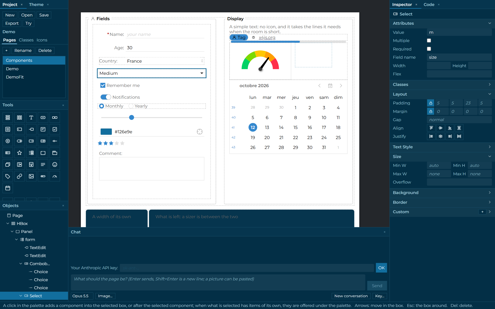

# x4studio

Design the pages of your [x4js](https://www.npmjs.com/package/x4js) application on screen, instead of writing them.

## What it is for

In an x4js application, a page is a class that builds its components in code: boxes inside boxes, with fields, lists and buttons in them. Getting a layout right that way means writing, building, looking, and writing again.

x4studio takes that part over. You compose the page on screen with the real x4 components, and the studio writes the TypeScript class for you. You derive your own class from it and write what only you can write: what the page does.

The layout stays in the studio, the behavior stays in your code, and the two never overwrite each other.

## What you can do

**Build a page.** Click a component in the palette: it goes into the box you selected. Boxes, panels, forms, tabs and split boxes hold the rest: text fields, checkboxes, lists, sliders, buttons, calendars, gauges and more. The tree shows the structure of the page, and lets you select what is hard to click. What you do to a page can be undone.

**Set it up.** The inspector shows the component you selected: its own attributes first (a label, a placeholder, an icon), then its look, in sections: layout, text, size, background, border. A field you left empty shows what applies.

**Give it your style.** Create classes ("card", "title", "danger") once, and give them to any component of any page. Change the class, and every component that has it follows.

**Set the theme of the application.** Choose a base color and the studio computes the whole scale. Pick the colors of a logo or of a screenshot. Go further control by control if you need to.

**Use your icons.** Drop your svg files onto the studio, then pick them from a preview wherever a component takes an icon.

**Try the page.** One click and the page is alive, as it will be in your application: tabs change, lists drop down, fields are typed in. One more and you are editing again.

**Ask Claude.** Describe the page you want, or paste a mockup or a screenshot: the assistant builds it in front of you, in the page, where you can go on by hand. It needs your own Anthropic API key, which stays in your browser.

**Take the code.** Each page is a readable TypeScript class, written the way you would write it. The components you named are typed members you reach from your own class. Export the project as a zip, and put it in your application.

## How a session goes

1. Open the studio in a browser. It starts on a demo project; make your own with "New", or open a zip you exported before.
2. Add pages, and build them.
3. "Save" keeps the project in the browser, so it is there when you come back. "Export" gives you the zip.
4. In your application, derive a class from each generated page, and write its code.
5. To change a page, open the project again: your own classes are untouched.

## Where it stands

x4studio is young (0.1.0) and moves fast. It runs in a browser; a desktop version is planned.

Not there yet: events and data binding (they are written in your derived class), the components that are built from data (grids, trees, charts), opening a page that was written by hand, and previews in several screen sizes.

## More

- [technical.md](technical.md): how it is made, what it generates, how to build it.
- [todo.md](todo.md): what was decided and why, and what is open.

Made by Etienne Cochard, author of x4js, with Claude.
